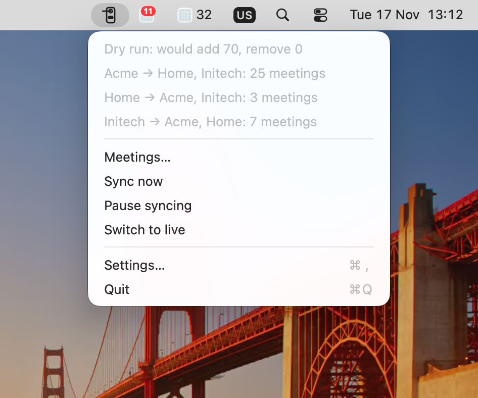
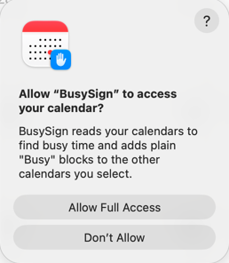
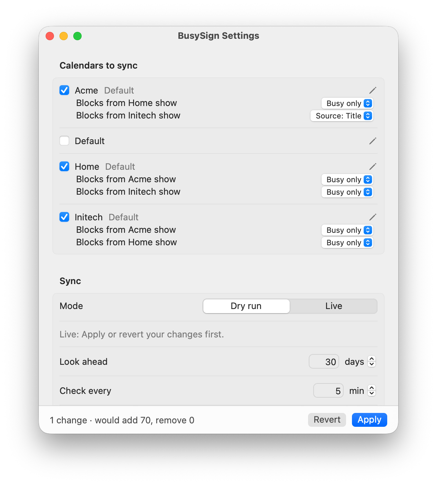
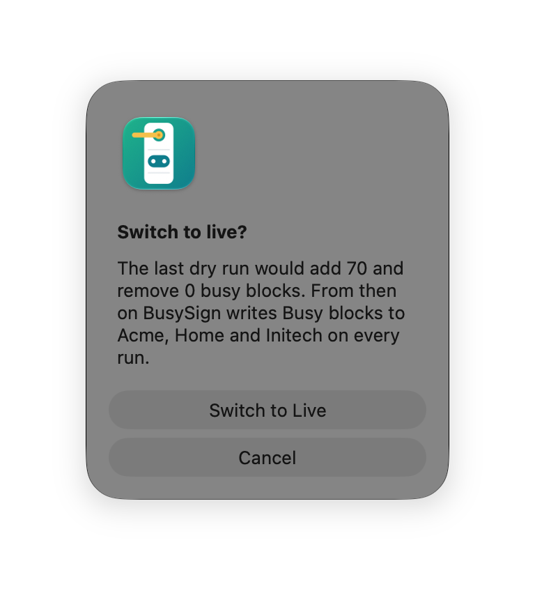
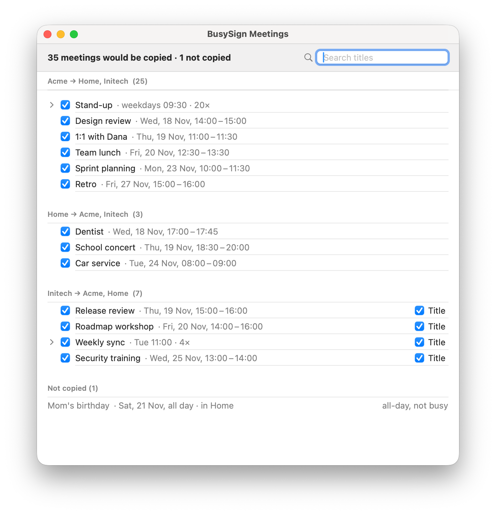

# BusySign

A small macOS menu-bar app that keeps "Busy" blocks in sync between the calendars you pick in macOS Calendar.

<p align="center"></p>

## Why BusySign

Say you have two or more calendars, your company's in Google and a client's in Exchange. People who book you on one side can't see your meetings on the other, so you get double-booked. BusySign puts a plain Busy block in each calendar for every meeting in the others, so whoever books you in any of them sees that you're taken. They don't see what the meeting is, unless you let a calendar's blocks show the meeting titles.

## Highlights

- Works through the accounts you already have in macOS Calendar (System Settings → Internet Accounts) - Exchange and Microsoft 365, Google, iCloud. It reads and writes events with EventKit, the same way Calendar does. Exchange accounts rely on EWS, see [Microsoft 365 and Exchange accounts](#microsoft-365-and-exchange-accounts).
- No server, no Microsoft Graph or Google API, and nothing to register in any tenant.
- Starts in Dry run, so you see what it would add and remove before anything is written.
- For each pair of calendars you pick what the blocks show - "Busy only", "Title", "Source: Title", or "Nothing" for a one-way sync.
- A Meetings window to leave single meetings out or keep their titles hidden.
- It only ever changes or removes its own Busy blocks, and it never sends invitations.
- Apart from the titles you choose to show, no details of your meetings leave the Mac.
- Ready builds for Apple silicon Macs, installed with Homebrew. BusySign itself needs no admin rights.

## Install

### Requirements

- macOS 15 Sequoia or later
- [Homebrew](https://brew.sh) - if your Mac is managed and you can't install it yourself, ask your IT
- on an Intel Mac, where Homebrew builds from source, the Xcode Command Line Tools (`xcode-select --install`) - Homebrew's installer usually sets them up already, full Xcode is not needed
- the calendars you want to sync, already showing up in macOS Calendar

You don't need admin rights to install or run it.

### Install with Homebrew

```sh
brew install v0rest/tap/busysign
```

The full name matters. Homebrew only loads formulae from third-party taps you trust, and naming the formula in full adds the tap and trusts this one formula in one go. A plain `brew install busysign` would be refused.

On a Mac with Apple silicon Homebrew downloads a ready build, made and tested on macOS 15, 26 and 27 - a newer macOS gets the newest of them. On an Intel Mac it builds the app from source with the Swift compiler from the Command Line Tools, which takes a little longer. Either way the app is signed ad hoc, since there is no paid Apple developer account behind it yet.

The app stays in Homebrew's folder, not in /Applications, and you start it with

```sh
open "$(brew --prefix)/opt/busysign/BusySign.app"
```

### A link in /Applications (optional)

To have BusySign in /Applications as well, add a link there once.

```sh
ln -sfn "$(brew --prefix)/opt/busysign/BusySign.app" /Applications/BusySign.app
```

That needs an admin account. With a standard one, link it into ~/Applications instead, the same command ending in `~/Applications/BusySign.app` (`mkdir -p ~/Applications` first if it isn't there). The link points at Homebrew's `opt` folder, so it keeps working after every upgrade. Finder opens BusySign through it, Spotlight doesn't list the link.

### A signed app is on the way

This will get simpler. The enrollment in the Apple Developer Program is submitted and waits for Apple's approval, which can take from a few days to a few weeks. Once it's through, the plan is to sign BusySign with a Developer ID, have Apple notarize it and ship it as a Homebrew cask, which installs it straight into /Applications. With a stable signature macOS also keeps its calendar access across upgrades. Until then it works as described here.

## Quick start

BusySign has no Dock icon, it lives in the menu bar as a small door-hanger sign.

### 1. Allow calendar access

The first time BusySign starts, macOS asks whether it may access your calendars. Allow it - without that it can't do anything.

<p align="center"></p>

### 2. Pick your calendars

Open Settings… from the menu-bar icon. It shows one row per account, its main calendar under a short name like "Acme" that you can change with the pencil, and the account's other calendars under "Other calendars". Calendars BusySign can't write to, birthdays and subscribed calendars aren't listed unless already ticked.

Nothing is ticked at first. Tick the calendars you want to keep in sync and click Apply in the bar that shows up at the bottom of the window. Nothing runs until at least two are ticked and applied.

<p align="center"></p>

### 3. Check the dry run

BusySign starts in Dry run. It reads the selected calendars and works out what it would do, but writes nothing. The menu shows something like "Dry run: would add 70, remove 0" and a line per calendar like "Acme → Home, Initech: 25 meetings", as in the picture at the top.

Look at whether those numbers make sense for your next few weeks. Dry run really writes nothing, not even when you untick a calendar and apply - the Busy blocks in that calendar wait for Live, see [Removals that wait for Live](#removals-that-wait-for-live).

### 4. Switch to live

When the numbers make sense, pick "Switch to live" in the menu (or Mode → Live in Settings). It asks once more with what the last dry run planned, and from then on every run writes.

<p align="center"></p>

"Switch to live" stays greyed until a dry run with the current settings has finished. While changes wait for Apply it says "Apply or revert your changes first", and a click on Live in Settings makes the Apply bar flash.

Run BusySign in Live on one Mac only, see [Using more than one Mac](#using-more-than-one-mac).

## Everyday use

By default BusySign looks 30 days ahead, checks every 5 minutes and shortly after anything changes in Calendar, and starts at login. All of that can be changed in Settings. BusySign only sees what Calendar has already synced, so a meeting booked on the server turns into a Busy block once Calendar has picked it up.

### Settings and the Apply bar

A change that decides what BusySign writes doesn't take effect when you make it, it waits for Apply.

- Waits for Apply - the calendar ticks, Look ahead, "Treat unanswered invitations as busy", the "Blocks from … show" lines, the short names and "Clear exclusions" in Settings, and the checkboxes and Title boxes in the Meetings window.
- Acts at once - Mode, Check every, Start at login, pausing and "Remove all Busy copies…".

While something waits, a bar at the bottom of Settings and of the Meetings window says what it would do, worked out like a dry run, say "1 change · would add 70, remove 0". It says "Working out…" for a moment while it counts.

<p align="center"></p>

The bar shows up as soon as you change something, also while you're still typing a Look ahead or a short name, no Return needed. Escape in that field puts back what it had before you started typing. That's where you catch a calendar ticked by mistake, before a single block is written.

Apply makes the changes your settings - in Live the next run writes them, in Dry run the next dry run shows them in the menu. Revert throws them away. Closing the window keeps the changes waiting and the menu then shows "Changes not applied - open Settings", while quitting BusySign drops them.

<details>
<summary>When the bar can't work out the counts</summary>

When the counts can't be worked out, say a calendar can't be read, the bar shows the reason instead and Apply stays greyed until they can. It tries again every 10 seconds for the first minute and then every minute, and clears by itself once the cause is gone.

When a calendar suddenly shows no events, the bar gives the counts with that reason after them, still with Apply greyed. It clears by itself after about five minutes or as soon as the calendar's events are back. Shortening Look ahead is the one case Apply takes at once even then, since a calendar can easily have no meeting of its own in the shorter window.

</details>

### Unticking a calendar

Unticking a calendar doesn't ask anything, the bar adds how many Busy blocks would go from it, say "remove 12 from Initech".

- In Live Apply removes them right away, since no run would clean them up later.
- If only one ticked calendar would be left, syncing stops and the bar ends with "syncing stops". In Live Apply also clears that calendar's Busy blocks.
- In Dry run Apply removes nothing, the removal waits for Live instead, see [Removals that wait for Live](#removals-that-wait-for-live).

### The Meetings window

Meetings… in the menu, or the button next to the status in Settings, opens a window with every meeting BusySign looks at, grouped by the calendar it comes from.

- A ticked meeting gets a Busy block in the other calendars its calendar copies to. Untick it and BusySign leaves it out.
- A recurring series is one row with one checkbox for the whole series. Open it to tick or untick single days - the box shows a dash when only some days are copied.
- Meetings BusySign doesn't copy anyway, declined or marked free for example, are listed greyed with the reason.

<p align="center"></p>

These ticks wait for Apply like the settings do, with the same bar at the bottom of the window, and until then the header says "Changes not applied" instead of the counts. In Live the next sync after Apply writes them, and the rows then say what was added, moved or removed.

The titles show only in this window on this Mac, unless you let a calendar's copies show them, see [What the copies show](#what-the-copies-show). BusySign keeps your choices on this Mac as well, as opaque keys rather than titles.

### What the copies show

What a copy is called you pick per pair of calendars, by where the meeting comes from and where its Busy block goes. In Settings every ticked calendar has a line under it for each other ticked calendar. Under Acme, say, "Blocks from Initech show" is where you pick what the Busy blocks for Initech meetings show in Acme. The list has four choices, in this order.

- "Nothing" - no Busy blocks on that pair at all, see [One-way sync](#one-way-sync)
- "Busy only" - the default, every copy is called "Busy"
- "Title" - the meeting's own title, say "Weekly sync"
- "Source: Title" - the short name of the calendar the meeting comes from in front, so an Initech meeting turns up in Acme as "Initech: Weekly sync"

With a third calendar ticked, say a personal one you named Home, every ticked calendar gets one more line. That's how Acme in the Settings picture above shows the titles of the Initech meetings, while the blocks for Home meetings in it stay "Busy".

A pair you never picked anything for shows "Busy only", so a calendar you tick later neither sends nor gets titles until you pick them for its pairs. Applying an untick forgets the choices of every pair the calendar is part of, so when you tick it again it starts at "Busy only" everywhere. A calendar you untick and tick again before Apply keeps the choices it had.

Some meetings shouldn't show their title anywhere. As soon as a line lets a calendar's meetings show their titles, like "Blocks from Initech show" under Acme in the pictures, the Meetings window gets a Title box on the Initech meetings, on a series and on its single days as well. Untick it and that meeting's copies say "Busy" in every calendar, whatever the "Blocks from … show" lines say.

BusySign can't tell which meetings are marked Private in Outlook or Google, since Calendar doesn't pass that on. So a pair that shows titles shows theirs too, until you untick them in the Meetings window.

More on titles in [Titles in detail](#titles-in-detail).

## In detail

### What counts as busy

- An event counts as busy unless it's marked free or you declined it.
- Invitations you haven't answered don't count, unless you switch on "Treat unanswered invitations as busy".
- All-day events count only when they're marked busy or out of office, so an all-day reminder that shows as free doesn't block the whole day.
- If the other calendar already has a real busy event at exactly the same time, say the same meeting you were invited to on both sides, BusySign doesn't put a Busy block on top of it.

### Removals that wait for Live

In Dry run Apply removes nothing, the removal waits for Live instead, also across a quit. The menu and the status in Settings then show a line per calendar, say "Would remove 12 Busy blocks from Initech in Live", worked out again after every dry run.

- The confirmation of "Switch to live" adds "It would also remove 12 Busy blocks from Initech, which you stopped syncing". Once you confirm, those blocks go first, before the first live run.
- If one can't be removed then, BusySign tries again after every live sync, and until it works the menu says "Busy blocks in Initech could not be removed yet".
- With fewer than two calendars ticked Live can't be switched on, so the line says "Busy blocks stay in Initech - "Remove all Busy copies…" removes them" instead.
- Tick the calendar again and apply, with at least one other calendar ticked, and it's synced as before with nothing left to remove.

"Remove all Busy copies…" is the one button that removes Busy blocks in any mode, and it clears these calendars as well.

### Titles in detail

The short name in "Source: Title" is the one you gave the calendar with the pencil, or the account's default if you never renamed it. Renaming it with the pencil pins the name in the copies, while the account's default can move to another calendar of that account when Calendar's default calendar changes. A rename waits for Apply as well, until then only that calendar's own row shows the new name and the copies keep the old one.

Who gets to read the title is down to how the calendar is shared in Exchange or Google, BusySign only writes it. Colleagues who may only see when you're free or busy still see a plain busy slot, and the title shows to those who may see your event details.

BusySign doesn't edit a copy in place, so a new title means a new copy - it adds one with the new title and then removes the old one, the same as for any other change.

- In Live that happens on the next sync after you apply a new "Blocks from … show" choice, a Title box or a new short name for a calendar whose meetings go out as "Source: Title". The bar shows how many copies it would be before you apply, "1 change · would add 0, remove 0, retitle 12".
- A meeting renamed in Calendar doesn't wait for Apply, its copies get the new title on the next sync. In Dry run the menu shows how many it would be, "Dry run: would add 0, remove 0, retitle 12".
- A new title only reaches copies from today to the end of the look-ahead. A copy before today keeps the title it had, and one further ahead gets its new title once it comes into the look-ahead.

<details>
<summary>The same meeting in two calendars</summary>

When the same meeting is in two of the ticked calendars at the same time, say you're invited to it in two accounts, BusySign takes its Busy block in your other calendars from one of them, the one the Meetings window lists it under. The "Blocks from … show" line of that calendar's pair decides what the block shows.

If the two have different times, say one account hasn't caught up with a move yet, each one gets a block in the other calendar and each block follows its own pair, while a third calendar gets one block, from the one that starts first.

</details>

<details>
<summary>Coming from a version with one choice per calendar</summary>

If you come from a version where this was one choice per calendar, the upgrade gives that choice to every pair into the calendar, from the calendars ticked at that moment. So the copies keep what they showed and you only change the pairs that should differ.

</details>

### One-way sync

The first choice in the list, "Nothing", puts no Busy blocks on that pair at all, which is how you sync one way only. Say Home should block time in your work calendars while work meetings stay out of it. Then "Blocks from Acme show" under Home goes to "Nothing" and the lines under Acme stay on "Busy only".

After Apply the next sync in Live removes the Acme blocks already in Home, from today to the end of the look-ahead, and the bar counts them before you apply.

- A calendar whose meetings go nowhere any more shows in the menu as "Acme: not copied", for example when only Acme and Home are ticked.
- A pair on "Nothing" is left out when BusySign picks which of two calendars a shared meeting takes its block from. The block in that calendar comes from the other one instead, and the Meetings window can then list that meeting under both calendars.
- Applying an untick forgets "Nothing" like any other choice, so a calendar you tick again starts at "Busy only" on every pair and gets and sends blocks again. Set those pairs back to "Nothing" before you apply, the bar shows the blocks it would add.

### What a copy carries

Every copy shows as Busy and has no alarms, attendees, location or URL. The notes hold only an opaque identifier, `busysign-v1:` and 22 more characters. It's a one-way hash of the original event's ID, which lets BusySign recognise its own blocks on every Mac, and nobody can read the meeting back out of it. BusySign never changes or deletes an event without it.

Apart from the titles you choose to show, no details of your meetings leave the Mac. BusySign has no network access of its own and no telemetry, and its logs stay in the macOS log. The Busy blocks reach Exchange or Google the same way your own events do, through Calendar's account sync, and with "Busy only" the only thing they carry over is the time slot.

## After every upgrade

`brew upgrade busysign` installs a new build, and since it's signed ad hoc, macOS treats every new build as a different app and asks for calendar access again. So upgrade in three steps.

1. Quit BusySign from its menu before you upgrade.
2. Run `brew upgrade busysign`.
3. Open it again with the `open` command from [Install with Homebrew](#install-with-homebrew) and allow calendar access.

If macOS doesn't ask and Settings says "Calendar access needed", click Open Privacy Settings and switch BusySign on under Privacy & Security → Calendars.

## Using more than one Mac

Run BusySign in Live on one Mac only. On any other Mac with the same accounts leave it in Dry run, where it only shows what it would do and writes nothing, or don't install it there at all.

If you see the same Busy blocks appear and disappear, check whether BusySign is live on another Mac and switch one of them to Dry run.

<details>
<summary>Why two live Macs undo each other</summary>

BusySign keeps no list of its own, each Mac decides from what its own Calendar shows.

- If one Mac's account lags behind or the company blocks Exchange on it, or the Macs have different calendars ticked or a different "Treat unanswered invitations as busy" setting, one Mac adds a Busy block that the other takes for a leftover and removes, or puts back a block for a meeting that was cancelled in the meantime. The two keep undoing each other on every run.
- Titles work the same way. If the Macs have a different choice on any "Blocks from … show" line or different Title boxes ticked in the Meetings window, each one keeps putting its own title on the same blocks.
- A pair on "Nothing" on one Mac and not on the other does the same to whole blocks - one Mac adds them and the other removes them, on every run.

</details>

## Microsoft 365 and Exchange accounts

macOS Calendar talks to Exchange accounts, Microsoft 365 included, over EWS (Exchange Web Services). Microsoft started disabling EWS for non-Microsoft apps in Exchange Online in October 2026 and turns it off completely in April 2027. If Apple doesn't move Calendar to something else before your organisation loses EWS, the Exchange account simply stops updating in Calendar, and BusySign only ever sees what Calendar has.

BusySign can't fix that, but it notices when a calendar goes quiet.

- When a selected calendar shows no new or changed event for a week, its row in Settings says "No new events for a week", and the tooltip on it suggests checking the account in Calendar → Settings → Accounts.
- There is no warning in the menu and no notification, since a quiet week off can show the note as well. So first check in Calendar itself whether that account still updates.
- If a calendar suddenly shows no events at all, BusySign waits 5 minutes before it removes the Busy blocks that came from it, and the sync that does it says "1 calendar shows no events" in the menu. An emptied calendar doesn't count as a change, so after a week it gets the note as well.

## Uninstall

Remove the Busy blocks first, while the app is still there.

1. In Settings, under Clean up, click "Remove all Busy copies…". That pauses syncing and deletes every Busy block BusySign added to the selected calendars from today on, and to the ones whose removal still waits for Live. Your own events stay as they are. If BusySign runs on another Mac as well, do this there first, otherwise that Mac puts the blocks back.
2. Once the summary shows up, switch off "Start at login", quit BusySign from its menu and remove it.

```sh
rm -f /Applications/BusySign.app ~/Applications/BusySign.app   # the link, if you added one
brew uninstall busysign
brew untap v0rest/tap
```

The settings stay in macOS preferences, `defaults delete io.github.v0rest.busysign` removes them too.

## License

MIT, see [LICENSE](LICENSE).
